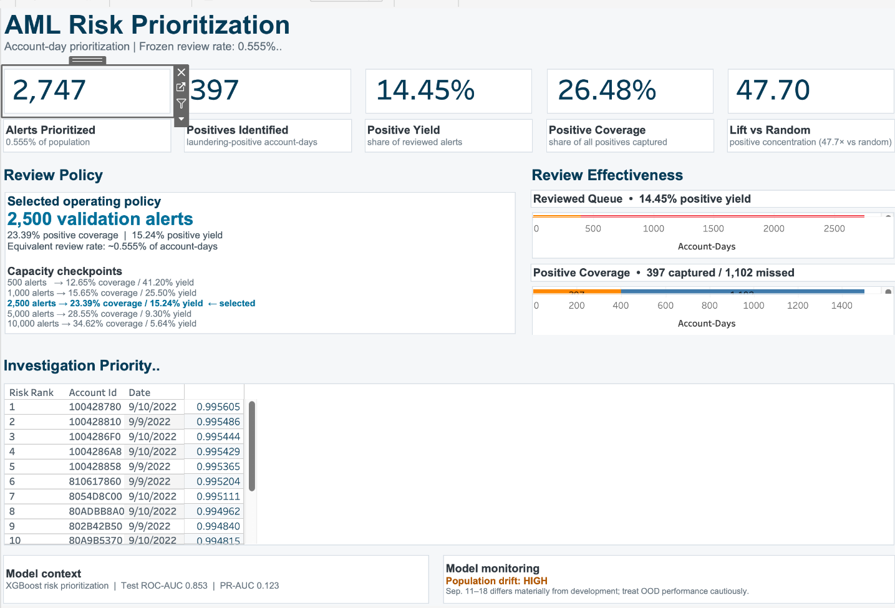

# AML Risk Prioritization - End-to-End Analytics Portfolio Project

A portfolio project that treats anti-money-laundering model development as an **investigator prioritization problem**, not just a binary-classification exercise.

## Executive result

Using synthetic AMLSim-derived transaction data, I built an account-day feature pipeline in MySQL, compared a class-balanced logistic baseline with an XGBoost challenger, froze an investigator review policy on validation data, evaluated it once on a later in-distribution test set, explained the model with SHAP, tracked experiments with MLflow, and stress-tested the frozen model against a later OOD population.

**Frozen test policy**

| Metric | Result |
|---|---:|
| Test population | 494,707 account-days |
| Review rate | 0.555% |
| Alerts prioritized | 2,747 |
| Positives identified | 397 |
| Positive yield (precision) | 14.45% |
| Positive coverage (recall) | 26.48% |
| Lift vs random review | 47.7x |
| ROC-AUC | 0.8529 |
| PR-AUC | 0.1231 |

## Why this project is different

The model is evaluated in the language an AML operations team would actually use: **How many alerts can investigators review, how many positive account-days does that queue capture, and how concentrated are positives relative to random review?** A default probability threshold would have produced an impractically large queue, so top-K capacity analysis became part of model selection.

## Architecture

`Synthetic transactions -> MySQL account-centric view -> account-day features -> temporal train/validation/test -> logistic baseline -> XGBoost -> capacity policy -> SHAP / cost sensitivity / MLflow -> OOD drift monitoring -> Tableau`

## Key design decisions

- **Temporal validation:** Sep. 1-6 train, Sep. 7-8 validation, Sep. 9-10 test; Sep. 11-18 is reserved for OOD monitoring.
- **Account-day grain:** transaction activity is aggregated from both sender and receiver perspectives so each account-day can be ranked for review.
- **Leakage control:** account/date identifiers remain for traceability and splitting but are not predictors; test and OOD periods are not used for tuning.
- **Imbalance-aware metrics:** PR-AUC, top-K precision/recall, lift, and capacity are emphasized over accuracy.
- **Operational policy:** 2,500 validation alerts is frozen before test evaluation; the equivalent test review rate yields 2,747 alerts.
- **Governance:** OOD Sep. 11-18 has a 99.89% positive rate and large feature shifts, so it is presented as a drift warning rather than ordinary performance evidence.

## Repository guide

- [`sql/AML_Portfolio_Pipeline.sql`](sql/AML_Portfolio_Pipeline.sql) - feature-engineering and validation SQL.
- [`notebooks/AML_Model_Development_Portfolio.ipynb`](notebooks/AML_Model_Development_Portfolio.ipynb) - model development, evaluation, SHAP, MLflow, drift, and Tableau export.
- [`tableau/AML_Risk_Prioritization.twbx`](tableau/AML_Risk_Prioritization.twbx) - packaged Tableau dashboard.
- [`reports/Model_Development_and_Validation_Report.pdf`](reports/Model_Development_and_Validation_Report.pdf) - interview-ready technical report.
- [`docs/INTERVIEW_DEFENSE_GUIDE.md`](docs/INTERVIEW_DEFENSE_GUIDE.md) - likely technical interview questions and concise answers.
- [`docs/DEVELOPMENT_NOTES.md`](docs/DEVELOPMENT_NOTES.md) - hurdles, fixes, and limitations.
- [`data/README.md`](data/README.md) - source-data and reproduction notes.

## Important limitation

This is a **synthetic-data portfolio project**, not a production AML detection system. Labels, population construction, costs, and operational capacity are illustrative. The OOD period is especially unusual and should not be interpreted as an unbiased future-production sample.
