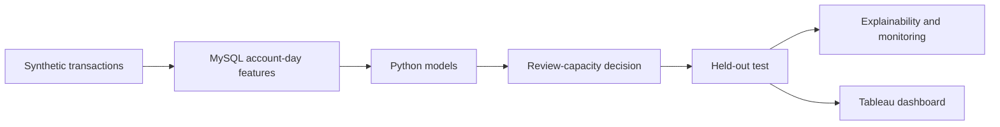

# AML Risk Prioritization | From Transactions to Investigation Decisions

**Can machine learning help investigators find more potentially suspicious activity without increasing their workload?**

That is the question behind this portfolio project. I used synthetic financial transactions to build a model that **ranks account-days for review**. Rather than treating every model alert equally, the goal is to place the most useful cases at the top of a limited investigation queue.

**[See the dashboard](#the-investigation-dashboard)** · **[Follow the journey](#the-project-journey)** · **[Read the notebook](notebooks/AML_Model_Development_Portfolio.ipynb)** · **[Understand the limitations](#important-limitations)**

> **Synthetic-data demonstration:** These results describe a portfolio exercise, not a deployed bank system or confirmed financial crime.

## The result

On a held-out test period, the model selected **2,747 account-days** for investigation from a population of **494,707**. Among those selected, **397** had positive synthetic labels.

| Investigation question | Held-out result |
|---|---:|
| How many account-days were available? | 494,707 |
| How many would be reviewed? | 2,747 (0.555%) |
| How many positive labels were captured? | 397 |
| What share of reviewed cases were positive? **Precision** | 14.45% |
| What share of all positives were captured? **Recall** | 26.48% |
| How concentrated were positives compared with random review? **Lift** | 47.7x |

**In plain English:** A small ranked queue concentrated positive labels much more effectively than random selection. That does not prove the selected accounts committed financial crime.

## The project journey

I organized the work around questions that an investigator or analytics team would naturally ask.

| Step | Question | What the project does |
|---|---|---|
| **01. Understand** | What should one investigation record represent? | Build one record per account per day from synthetic transactions. |
| **02. Prepare** | Which activity patterns could be useful? | Summarize counts, amounts, counterparties, banks, and transaction behavior in MySQL. |
| **03. Compare** | Is a simple model enough? | Start with logistic regression and compare its ranking with XGBoost. |
| **04. Prioritize** | What if investigators can review only a limited number of cases? | Compare top-ranked cases at different review capacities. |
| **05. Validate** | Does the chosen approach work on later data? | Freeze the model and review policy before testing on a later period. |
| **06. Explain** | Can the result be understood and used? | Add SHAP explanations, drift checks, and a Tableau investigation dashboard. |

## Three decisions that shaped the project

### 1. A good model is not necessarily a manageable review queue

The logistic-regression baseline generated **more than 115,000 validation alerts** at a default 0.50 threshold. Instead of assuming investigators could work through that volume, I evaluated how many positives appeared in the **highest-ranked cases** at realistic queue sizes.

### 2. Test on later data without tuning to the answer

The chronological windows were **September 1–6, 2022** for training, **September 7–8** for validation, and **September 9–10** for the held-out test. The operating policy selected **2,500 validation alerts**. Applying the equivalent review rate to the test population yielded **2,747 reviewed account-days**.

### 3. Treat suspiciously strong results with caution

A separate September 11–18 monitoring population contains **922 positive labels among 923 records**. This is an extreme shift in label distribution, so the project treats it as a **drift warning**, not proof of extraordinary model performance.

## The investigation dashboard

The Tableau dashboard presents the outcome in the language of review operations: review capacity, positives identified, precision, recall, lift, score distribution, model explanations, and ranked account-days.

**[Open the packaged Tableau workbook](tableau/AML_Risk_Prioritization.twbx)**

This is a downloadable Tableau workbook, **not yet a live website**. A browser-based portfolio experience is planned as a separate presentation layer.

## Explore the work

Start with the story; open the technical details when you want to go deeper.

| Resource | What you'll find |
|---|---|
| **[Model development notebook](notebooks/AML_Model_Development_Portfolio.ipynb)** | The baseline, XGBoost comparison, review policy, held-out evaluation, and explanations. |
| **[SQL feature pipeline](sql/AML_Portfolio_Pipeline.sql)** | How transaction activity becomes account-day features. |
| **[Development notes](docs/DEVELOPMENT_NOTES.md)** | Problems encountered, decisions made, and limitations. |
| **[Validation report](reports/Model_Development_and_Validation_Report.pdf)** | Detailed methods and technical evidence. |
| **[Interview defense guide](docs/INTERVIEW_DEFENSE_GUIDE.md)** | Questions and trade-offs worth understanding. |
| **[Data/setup notes](data/README.md)** | Source-data assumptions and reproduction requirements. |

**Tools:** MySQL and SQL for features; Python, pandas, scikit-learn, and XGBoost for modeling; SHAP for explanations; MLflow for experiment tracking; Tableau for decision support.

### Reproduction status

The original notebook ran in Google Colab and includes Google Drive-specific paths. **The full workflow is not currently one-click reproducible from this repository alone.** The data notes describe the required inputs; a smaller, portable walkthrough is a planned improvement. I prefer to state this clearly rather than claim an unverified setup.

## Important limitations

- **Synthetic labels are not confirmed illicit activity.** Real investigations require appropriate outcomes, human review, and governance.
- **Risk scores are ranking values**, not calibrated probabilities or proof of wrongdoing.
- **Review capacity and error costs are illustrative**, not measured bank operating costs.
- **The later monitoring sample is highly unusual**, so it cannot establish future production performance.
- **SHAP explains model behavior, not causation.**

## What's next

Simplify the main notebook into a guided, interview-defensible journey; make setup easier; and publish a live project page using verified, precomputed results. These presentation changes should not alter the frozen held-out evaluation.

---

**Project focus:** translating model rankings into understandable, capacity-constrained investigation decisions.
